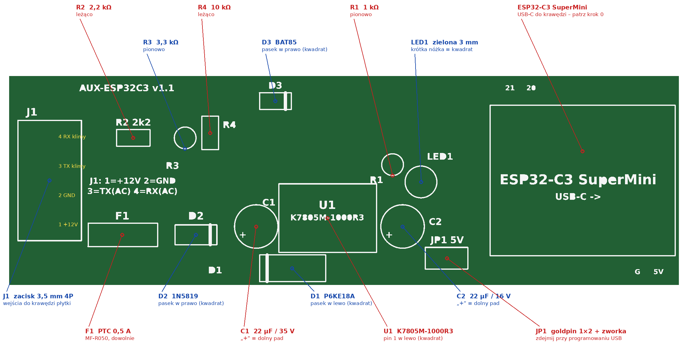

# Klimatyzator AUX / Sevra w Home Assistant – lokalnie, bez chmury

Własny moduł Wi‑Fi na **ESP32‑C3** z **ESPHome** i komponentem [`aux_ac` (GrKoR)](https://github.com/GrKoR/esphome_aux_ac_component) zamiast oryginalnego modułu AC Freedom. Pełne sterowanie z Home Assistant, bez chmury, za ok. 25 zł na klimę.

Skąd to się wzięło? Oryginalny moduł Wi-Fi gadał tylko z chmurą AC Freedom: integracja z HA była kulawa, a jak serwer miał gorszy dzień, to klimy znikały. Wyjąłem więc fabryczne moduły i włożyłem w ich miejsce własne na ESP32-C3. Najpierw lutowane z gotowych modułów, potem na własnej płytce. Wrzucam oba warianty, bo może komuś się przyda.

Sprawdzone na klimach **Sevra SEV‑18QV/I** (04.2022). Powinno działać z klimami na protokole AUX (AUX, Sevra, Idea, Rovex i inne klimy sterowane aplikacją AC Freedom), ale każdy model sprawdzaj sam.

> ⚠️ Robisz to na własne ryzyko. Ingerencja w urządzenie na gwarancji może ją unieważnić.

## Co działa

- tryby: auto, chłodzenie, grzanie, osuszanie, wentylator
- wentylator (w tym MUTE i TURBO), presety (SLEEP, CLEAN, HEALTH, ANTIFUNGUS), żaluzje pion/poziom
- temperatura wewnętrzna i zewnętrzna, moc sprężarki (%), odszranianie
- przełącznik wyświetlacza (np. gaszenie ekranu na noc automatyzacją)
- sygnał Wi‑Fi, czas pracy, restart

> ⚠️ **Gniazdo „USB” w klimie to NIE jest USB.** Daje **12–14 V** (w nowszych modelach ok. 8,5 V), a sygnały mają poziom **5 V**. ESP podłączone bezpośrednio się spali.

Są dwa warianty sprzętu. Program jest ten sam, różnią się tylko piny UART.

| | Wariant A – z modułów | Wariant B – własna płytka |
|---|---|---|
| Co lutujesz | 3 gotowe moduły na kabelkach | płytka 80 × 25 mm, same elementy przewlekane |
| Zasilanie 5 V | MP1584 (trzeba ustawić potencjometrem) | K7805M, bezpiecznik PTC, TVS, dioda |
| UART | GPIO4 / GPIO5 | GPIO21 (TX) / GPIO20 (RX) |
| Obudowa | taśma / koszulka | wydruk 3D „pendrive” |

---

## Wariant A – z gotowych modułów

### Części (na jedną klimę)

| Część | Uwagi |
|---|---|
| ESP32‑C3 SuperMini | przy słabym zasięgu wersja „Plus” z lepszą anteną |
| Przetwornica MP1584 mini (regulowana) | z 12–14 V robi 5 V |
| Konwerter poziomów BSS138, 4‑kanałowy | używasz 2 kanałów |
| Wtyczka USB‑A męska | najprościej ucięty stary kabel USB |
| Przewody 0,25 mm², koszulki termokurczliwe, taśma | |

### Schemat

```
GNIAZDO USB KLIMY        PRZETWORNICA         ESP32-C3              KONWERTER
pin 1 (+12–14 V) ─────── IN+
pin 4 (GND) ──────────── IN− ─┬────────────── GND ───────────────── GND
                              │
                         OUT+ (5,0 V) ─┬────── 5V
                                       └─────────────────────────── HV
                                               3V3 ─────────────── LV
                                               GPIO4 (TX) ──────── LV2 ─ HV2 ── pin 2 (RX klimy)
                                               GPIO5 (RX) ──────── LV1 ─ HV1 ── pin 3 (TX klimy)
```

UART: **4800 baud, 8E1**.

### Lutowanie

1. **Ustaw przetwornicę na 5,0 V, zanim podłączysz cokolwiek innego.** Podaj 12 V na IN i kręć potencjometrem, aż na OUT będzie 4,9–5,1 V. Nowe MP1584 często mają fabrycznie ponad 20 V.
2. **Zmierz żyły kabla USB miernikiem.** Zwykle: czerwony = pin 1, biały = pin 2, zielony = pin 3, czarny = pin 4. Tanie kable nie trzymają kolorów.
3. Zasilanie: czerwony → IN+, czarny → IN−. OUT+ → **5V** w ESP i **HV** w konwerterze. OUT− → **GND** w ESP i w konwerterze.
4. Strona 3,3 V: **3V3** → **LV**, **GPIO4** → **LV2**, **GPIO5** → **LV1**.
5. Strona klimy: **HV2** → pin 2, **HV1** → pin 3.
6. Zaizoluj wszystko koszulkami, przetwornicę i konwerter owiń taśmą lub włóż w małą obudowę.

---

## Wariant B – własna płytka AUX-ESP32C3 v1.2

Płytka zamiast pająka z kabelków: wtyczkę z klimy przykręcasz do zacisku J1, ESP32-C3 SuperMini siedzi na goldpinach. Wszystkie elementy są przewlekane, więc lutuje się łatwo.

<p align="center"></p>

**Jak działa:**
- **Zasilanie:** 12 V z klimy → bezpiecznik PTC 0,5 A (F1) → dioda 1N5819 (D2, ochrona przed odwrotnym podłączeniem) → TVS 18 V (D1) → przetwornica K7805M (U1) → 5 V dla ESP. Zielona dioda LED1 świeci, gdy jest 5 V.
- **Klima → ESP:** dzielnik R2 2,2 kΩ / R3 3,3 kΩ zbija 5 V do ok. 3 V na GPIO20.
- **ESP → klima:** GPIO21 przez diodę BAT85 (D3), linia podciągnięta do 5 V przez R4 10 kΩ.
- **JP1:** zworka na 5 V. **Zdejmij ją przy programowaniu przez USB-C**, żeby 5 V z komputera nie szło w płytkę.

**Złącze J1** (pin 1 = kwadratowy pad): 1 = +12 V (pin 1 wtyczki), 2 = GND (pin 4), 3 = TX klimy (pin 3), 4 = RX klimy (pin 2). Kolory żył sprawdź miernikiem.

**Pliki w [`pcb/`](pcb/):**

| Plik | Do czego |
|---|---|
| `AUX-ESP32C3_v1.2_gerber.zip` | gerbery do zamówienia (JLCPCB, PCBWay…): 2 warstwy, 1,6 mm, 80 × 25 mm |
| `AUX-ESP32C3_LCSC_BOM.csv` | lista części z numerami LCSC |
| `AUX-ESP32C3_co_gdzie.png` | rozmieszczenie i kierunki elementów |

**Lista części:**

| Oznaczenie | Element |
|---|---|
| U1 | przetwornica K7805M-1000R3 (SIP-3, 1 A) |
| F1 | bezpiecznik polimerowy PTC 0,5 A (MF-R050) |
| D1 | TVS P6KE18A |
| D2 | 1N5819 |
| D3 | BAT85 |
| C1, C2 | 22 µF / 35 V elektrolit 5 × 11 mm |
| R1 | 1 kΩ (pionowo) |
| R2 / R3 / R4 | 2,2 kΩ / 3,3 kΩ / 10 kΩ |
| J1 | zacisk śrubowy 4P raster 3,5 mm |
| LED1 | LED 3 mm zielona |
| JP1 | goldpin 1×2 + zworka |
| – | ESP32-C3 SuperMini + listwy goldpin |

> ℹ️ **v1.1 → v1.2:** w v1.1 wylewka masy na spodzie zwierała kilka ścieżek do GND. W v1.2 jest to poprawione (6 mostków usuniętych z warstwy B_Cu), ale napis na płytce dalej mówi „v1.1”. Jeśli masz stare płytki v1.1, napisz w Issues – da się je uratować nacięciem miedzi w 6 miejscach.

**W pliku urządzenia ustaw piny płytki:**

```yaml
uart:
  - id: !extend ac_uart_bus
    tx_pin: GPIO21
    rx_pin: GPIO20
```

GPIO20/21 to sprzętowy UART0 modułu, ale logi idą po USB (`hardware_uart: USB_SERIAL_JTAG`), więc jest wolny dla klimy.

---

## ESPHome

Pliki w repozytorium:

| Plik | Do czego |
|---|---|
| `klima-aux-wspolne.yaml` | wspólny pakiet – cała konfiguracja klimy |
| `klima-przyklad.yaml` | plik jednego urządzenia (zmieniasz tylko nazwy) |
| `secrets.yaml.example` | wzór sekretów |

### Opcja 1 – pliki lokalnie

1. Skopiuj `klima-aux-wspolne.yaml` do `/homeassistant/esphome/` jako **`.klima-aux-wspolne.yaml`** (kropka na początku = ESPHome nie pokaże go jako osobnego urządzenia).
2. Uzupełnij `secrets.yaml` w ESPHome według `secrets.yaml.example`.
3. W ESPHome: **New device**, wklej treść `klima-przyklad.yaml` i zmień nazwy.

### Opcja 2 – pakiet prosto z GitHuba

W pliku urządzenia zamiast `!include` wpisz:

```yaml
packages:
  aux: github://virus98pl/Ac-sevra-aux-esp-home/klima-aux-wspolne.yaml@main
```

Każda zmiana w repo trafi do klim po ponownym **Install**.

### Pierwsze wgranie

1. Pierwszy raz kablem USB‑C: **Install → Plug into this computer** (Chrome albo Edge). Kolejne wgrania przez Wi‑Fi.
2. **Płytka v1.2:** zdejmij zworkę JP1 i odłącz płytkę od klimy na czas wgrywania.
3. Jeśli komputer nie widzi portu albo wgrywanie się nie łączy: przytrzymaj przycisk **BOOT** na ESP32-C3, podłącz USB-C, puść BOOT i spróbuj jeszcze raz. Kabel USB-C musi przesyłać dane, nie tylko ładować.
4. Ustaw modułowi stały adres IP w routerze.

## Montaż w klimie

1. **Wyłącz klimę z prądu.**
2. Wyjmij oryginalny moduł Wi‑Fi i włóż swoją wtyczkę.
3. Włącz zasilanie i otwórz **Logs** w ESPHome. Po 10–20 s powinny pojawić się ramki `<=` / `=>`.
4. **`no pings from HVAC`** = TX i RX zamienione (zależy od rocznika klimy, ok. od 07.2022 bywa odwrotnie). Nie przelutowuj – zamień `tx_pin` z `rx_pin` w pliku urządzenia.
5. Home Assistant sam zaproponuje nowe urządzenie – dodaj je z kluczem API.

## Druk 3D

Obudowa „pendrive” do płytki v1.2 (katalog [`stl/`](stl/)): korpus, w który wsuwasz płytkę, i zatyczka na zatrzask od strony USB-C. Po złożeniu ok. 90 × 30 × 21 mm, bez śrub.

| Plik | Druk |
|---|---|
| `AUX-ESP32C3_pendrive_korpus.stl` | pionowo, zamkniętym końcem na stole, bez podpór |
| `AUX-ESP32C3_pendrive_zatyczka.stl` | płytką do stołu |

Najlepiej PETG albo ASA (przy klimie bywa ciepło), warstwa 0,2 mm.

## Problemy z Wi‑Fi

- **Sygnał poniżej ok. −75 dBm** → przybliż punkt dostępowy albo użyj ESP32‑C3 SuperMini Plus.
- **`output_power: 8.5`** jest ustawione celowo – przy wyższej mocy C3 SuperMini często gubi połączenie przez słabą antenę. Możesz spróbować 11–13 w pliku jednej klimy:
  ```yaml
  wifi:
    output_power: 13
  ```

## Źródła

- [GrKoR/esphome_aux_ac_component](https://github.com/GrKoR/esphome_aux_ac_component) – komponent i dokumentacja
- [Sprzęt i pinout](https://github.com/GrKoR/esphome_aux_ac_component/blob/master/docs/HARDWARE-EN.md)

## Licencja

MIT
